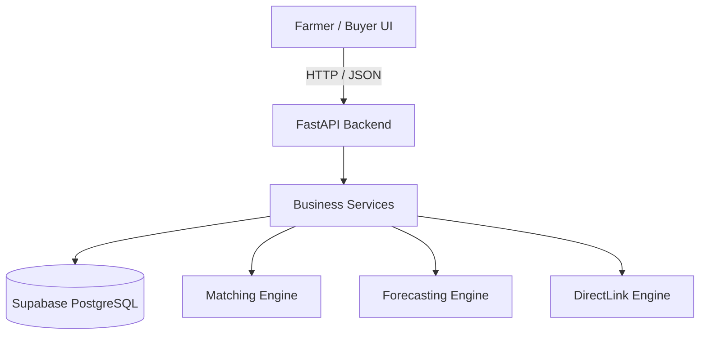

# Krishi Bazaar — SIH26132 (backend) + DirectLink (SIH26033)

[](krishi_bazaar_sih.postman_collection.json)

Market linkage and price discovery API for farmers (Government of Maharashtra / MSInS),
plus **DirectLink**, the disintermediation engine for SIH26033.

## DirectLink — cutting the chain (SIH26033)

> **Problem statement:** *multiple intermediaries reduce the farmer's earnings and
> increase the consumer's price.*

DirectLink attacks that from four directions: attribute the leak exactly, cut
the chain and re-price the trade, consolidate so small orders can ship, and
settle traceably so the claim can be audited.

```bash
python demo/direct_channel_demo.py      # the whole argument, offline
```

No database, no network, no API keys — every figure is computed live. Five
acts: where the consumer's rupee goes today, what one lane looks like with the
chain removed, why a housing society cannot fill a truck alone, a 60-lot ×
25-group district plan, and one crate's traceable receipt.

| Piece | Where |
|---|---|
| Algorithm and architecture | [`docs/DIRECT_CHANNEL.md`](docs/DIRECT_CHANNEL.md) |
| Engine (pure, no I/O) | `direct/` |
| HTTP API (9 routes) | `app/routers/direct.py` |
| Schema | `db/migrations/038_direct_channel.sql`, `039_direct_fulfilment.sql` |

**Both anchors are real published government data.** Farm gate: data.gov.in
daily mandi prices, Lasalgaon APMC onion modal **₹2,226/quintal** (26 Sep 2026,
committed in `data/gov_prices_60days.csv`). Retail: Ministry of Consumer
Affairs / Department of Consumer Affairs daily wholesale-and-retail dataset
(`fcainfoweb.nic.in`), **₹5,392/quintal**, loaded live when configured and from
a committed snapshot otherwise — see `ingestion/dca_retail.py`.

Headline result on those numbers: the farmer keeps **48 paise** of the
consumer's rupee, and **85%** of the ₹2,401/quintal spread is pure margin
rather than work done. DirectLink pays the farmer **₹3,663 (+64.5%)** and
charges the consumer **₹3,890 (−27.9%)** — both sides better off than their
fallback, by construction, not by assertion.

---

This repository holds the **FastAPI + Supabase backend**. The farmer/buyer PWA lives in [`web/`](web/) (Vite + React; see [`web/README.md`](web/README.md)), with its design record in [`docs/frontend/`](docs/frontend/). HTTP contract: [`docs/API.md`](docs/API.md). Layout: [`docs/ARCHITECTURE.md`](docs/ARCHITECTURE.md). How to contribute: [`CONTRIBUTING.md`](CONTRIBUTING.md).

## Problem → API

| SIH expected | This API |
|---|---|
| Aggregate mandi prices, arrivals, demand, logistics | `GET /prices/*` ingest from data.gov.in; `GET /buyers/`; `GET /logistics/` |
| Localised price trends + sale-window | `GET /sale-window/?lang=mr` → **Sell Now / Hold / Wait** |
| Match farmers/FPOs to verified buyers | `GET /lots/{id}/matches` and `/advice` (local-first score) |
| Lots, grading, digital offers, payments | `/lots/` `/offers/` `/payments/` |
| Logistics + disputes | `/logistics/bookings` `/grievances/` |
| Transparent record | `GET /lots/{id}/ledger` |
| **Where the consumer's rupee goes** (SIH26033) | `POST /api/v1/direct/rupee` |
| **What a direct trade should cost** (SIH26033) | `POST /api/v1/direct/fair-price` |
| **Match lots to consumers, optimally** (SIH26033) | `POST /api/v1/direct/plan` |
| **Pool orders until a truck is viable** (SIH26033) | `POST /api/v1/direct/group-buy` |
| **Scan a crate's receipt** (SIH26033) | `GET /api/v1/direct/trace/{token}` |

### Architecture


### Tech Stack Justification
- **FastAPI**: Chosen for its high-performance async capabilities and automatic OpenAPI (Swagger) documentation, ensuring rapid API development.
- **Supabase (PostgreSQL)**: Selected over NoSQL to ensure strict relational integrity (ACID) for financial transactions, lots, and ledgers. See [docs/SECURITY_MODEL.md](docs/SECURITY_MODEL.md) for our 4-layer RLS and state-machine architecture.
- **Pydantic**: Guarantees pre-route validation so the API never processes malformed data.

Demo seed: 5 Nashik APMCs × Onion, Tomato, Soybean, Maize. Expand via [`docs/ONBOARDING.md`](docs/ONBOARDING.md).

## Prerequisites

- **Python 3.12** (verified in CI matrix)
- A Supabase project (SQL applied per [`docs/SQL_APPLY.md`](docs/SQL_APPLY.md))
- Optional: Docker + Compose for a one-command API

## Local setup (Windows)

```bat
py -3.12 -m venv .venv
.venv\Scripts\activate
pip install -r requirements-dev.txt
copy .env.example .env
```

## Local setup (Unix / macOS)

```bash
python3.12 -m venv .venv
source .venv/bin/activate
pip install -r requirements-dev.txt
cp .env.example .env
```

Fill `.env` (never commit it). Run `make db-apply` (or `python scripts/apply_migrations.py`) to safely apply all database migrations.

**Seed the database**:
```bat
python seed.py
```

```bat
set RUN_SCHEDULER=0
set RATE_LIMIT_ENABLED=0
uvicorn app.main:app --host 127.0.0.1 --port 8000
```

- Health: `http://127.0.0.1:8000/health`
- OpenAPI (non-production): `http://127.0.0.1:8000/docs`
- Frontend origin: `CORS_ORIGIN` (comma-separated). Default includes `http://localhost:3000` and `http://localhost:5173`.

Unix / Make:

```bash
make install-dev
RUN_SCHEDULER=0 RATE_LIMIT_ENABLED=0 make run
```

## Environment variables

All keys are listed with comments in [`.env.example`](.env.example). Required to boot:

| Variable | Purpose |
|---|---|
| `SUPABASE_URL` | Project URL |
| `SUPABASE_ANON_KEY` | Public reads (RLS) |
| `SUPABASE_SERVICE_ROLE_KEY` | Jobs + authenticated handlers (never expose) |
| `SUPABASE_JWT_SECRET` | FastAPI HS256 verify |
| `SUPABASE_JWT_ISSUER` | Set to `https://<ref>.supabase.co/auth/v1` in production |
| `DATA_GOV_IN_API_KEY` | Mandi ingest |
| `AUTH_DB_ENFORCEMENT` | `rls` (DB boundary, default) or `app` (app-layer only, dev only) |
| `KB_ALLOW_APP_MODE` | Set `1` to allow app-mode in production (not recommended) |
| `KB_LIVE_SUPABASE` | Set `1` to enable `tests/test_rls_live.py` against a real project |
| `MAX_ARRIVAL_QTY_QTL` | Float limit for ingestion quantity sanity checks (default `1000000.0`) |

Important knobs: `CORS_ORIGIN`, `RUN_SCHEDULER`, `RATE_LIMIT_ENABLED`, `APP_ENV`, `INBOUND_HMAC_SECRET`, `TARGET_DISTRICT`.

See [`docs/SECURITY_MODEL.md`](docs/SECURITY_MODEL.md) for a full description of the four-layer security model, `AUTH_DB_ENFORCEMENT` modes, and the fail-closed production guard.

## Tests

```bat
set RUN_SCHEDULER=0
set RATE_LIMIT_ENABLED=0
ruff check .
pytest -q
```

Live checks (uvicorn + real `.env`):

```bat
python scripts/test_db.py
python scripts/exercise_rpc.py
```

**Demo rehearsal — run this before presenting:**

```bash
python scripts/rehearse_demo.py
```

Runs the numerical audit, the five-act demo, the migration linter, the suite and
ruff, and prints one PASS/FAIL line per step. `--fast` skips the suite.

**The demo itself needs no credentials at all:**

```bash
.venv/bin/python demo/direct_channel_demo.py
```

Judge path and the full runbook (what to say per act, what to say about
accuracy, recovery table): **[`docs/DEMO_RUNBOOK_DIRECTLINK.md`](docs/DEMO_RUNBOOK_DIRECTLINK.md)**.

> `docs/DEMO_RUNBOOK.md`, `docs/DEMO.md` and `demo/reconcile.py` /
> `demo/live_smoke.py` describe the pre-pivot Krishi Bazaar concept. The two
> demo scripts now live in `legacy/demo/`; the runbooks are kept for history and
> are banner-marked at the top.

## Known Limitations

We explicitly document what this prototype does *not* yet do to demonstrate our understanding of real-world generalization constraints (e.g. multi-lingual crop aliasing, complex transport models). See the "What Does Not Yet Generalize" section in [`docs/SCALING.md`](docs/SCALING.md).

- **Single-Worker**: Rate limiting and the APScheduler run in-process, requiring a single worker in production.
- **eNAM Payment Path**: External payment settlement flows (e.g. eNAM gateways) are mocked and lack full API integration.

## Forecasting Engine

The upgraded forecasting engine captures seasonality and market sentiment using an ensemble approach. For baseline stability, it uses a moving average (`ma`), while a feature-rich Ordinary Least Squares (`feature_ols`) model incorporates cumulative weather data and LLM-extracted structured intelligence (`event_pressure`). A Holt-Winters model (`holt_winters`) is also registered. A LightGBM gradient boosting model (`gbm`) exists but is **delisted from the default registry** until per-fold retraining makes it compatible with walk-forward isolation. Models are graded by the walk-forward backtesting harness; the published [`docs/accuracy_card.md`](docs/accuracy_card.md) is currently **BLOCKED** for insufficient live history, so no certified accuracy figure is claimed and automatic model promotion is disabled.

## Docker

Single worker is required (in-process scheduler + job locks).

```bash
docker compose up --build
```

Or:

```bash
docker build -t krishi-bazaar .
docker run --env-file .env -p 8000:8000 krishi-bazaar
```

Production image installs **only** `requirements.txt` (no pytest/ruff) and runs as uid 10001. Set `APP_ENV=production` to disable `/docs`.

## Auth (frontend)

`Authorization: Bearer <jwt>`. Role comes from `user_profiles`, not the token.

```bat
python demo/mint_admin_token.py --sub <auth.users uuid> --hours 2
```

Elevate only in SQL:

```sql
select public.admin_set_role('<uuid>'::uuid, 'admin');
```

## Farmer / FPO sequence

1. `PATCH /api/v1/me/` — phone E.164, `mr|hi|en`, lat/lng, district
2. `POST /api/v1/lots/` — qty, grade (`FAQ|General|Special`), asking price
3. `GET /api/v1/lots/{id}/advice` — Sell Now / Hold + **best local verified buyer**
4. `GET /api/v1/lots/{id}/matches`
5. `POST /api/v1/offers/` (48h TTL) → accept → `POST /api/v1/payments/` → `paid|failed|disputed`
6. `GET /api/v1/lots/{id}/ledger`
7. `POST /api/v1/grievances/` if quality / payment / logistics fails
8. `POST /api/v1/logistics/bookings` against a lot (capacity-checked)
9. FPO: `POST /api/v1/lots/aggregate`

SMS: registered number texts `PYAJ` / `कांदा` → modal + sale-window + buyer. Unknown MSISDNs are ignored.

Admin JWT (DB role `admin`): forecast/alert jobs, buyer verify, `/dashboard` (ops HTML only).

## Layout

```
app/              HTTP app (routers, schemas, auth, errors)
app/services/     Core business logic and engines
ingestion/        mandi adapters
forecasting/      7-day forecast engine
notifications/    sale-window + SMS
db/migrations/    Postgres / RLS
tests/            pytest + FakeSupabase
docs/             API, SQL, demo, architecture
demo/             live smoke / token mint
scripts/          operator helpers
```

Runtime config is environment variables, not a `config/` directory.

## CI

Every push/PR: Ruff, pytest (Python 3.12), `pip-audit` on production deps, secret-pattern grep. See `.github/workflows/ci.yml`.
